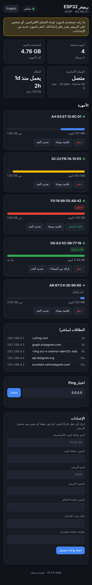
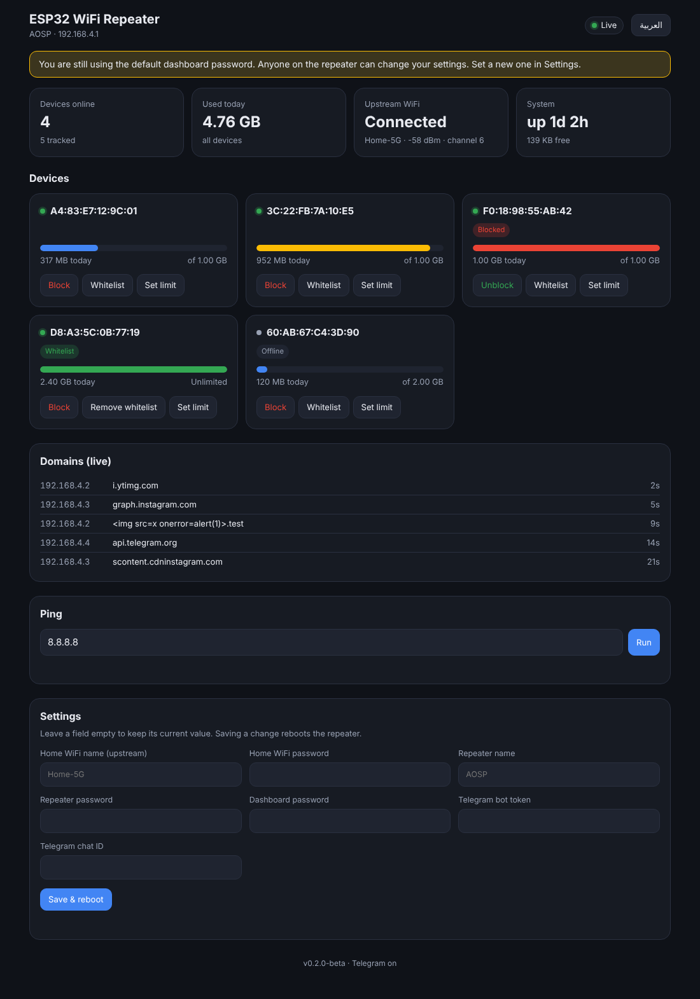

<div align="center" dir="rtl">

# ريبيتر واي فاي ESP32

**شارك الواي فاي بقصد. شوفه. وحدّده.**

ريبيتر مفتوح المصدر على ESP32 بيقوّي شبكة بيتك، ويعدّ استهلاك كل جهاز، ويفرض كوتة يومية لكل جهاز، ويديك لوحة تحكم مباشرة في المتصفح وبوت على تليجرام.

[](https://github.com/CodeVortax/esp32-wifi-repeater-manage/actions/workflows/build-firmware.yml)
[](CHANGELOG.md)
[](LICENSE)
[](#التثبيت)
[](#الخصوصية)

[English](README.md) · **العربية**

</div>

---

## لقطات الشاشة

<p align="center">
  
  
</p>

## إيه ده؟

فكرة واحدة: **أي حد بيستخدم إنترنتك لازم يكون ظاهر ومحدود.**

الـ ESP32 بيتصل براوتر بيتك كأنه جهاز، وبيفتح شبكة تانية جنبه. الموبايلات واللابتوبات بتتصل بالـ ESP32 وترافيكها بيتحوّل للراوتر (NAT). وعشان كل بايت بيعدّي عليه، يقدر يعدّ استهلاك كل جهاز، ويقطع جهاز لما يخلّص كوتته اليومية، ويوريك النطاقات اللي بتتفتح، ويبلّغك على تليجرام.

كل ده شغال على الشريحة نفسها. من غير سحابة ولا حساب ولا تطبيق.

## المميزات

### الريبيتر

| | |
|---|---|
| **AP + STA مع NAT** | الـ ESP32 بيتصل بالراوتر وبيشارك الإنترنت على شبكته. الـ NAT بيشتغل أول ما الراوتر يدّيه عنوان، وبعد أي إعادة اتصال. |
| **اتصال في الخلفية** | التشغيل مش بيستنى الراوتر، فاللوحة بتفتح على طول. |
| **DNS عن طريق الـ ESP32** | الـ DHCP بيدّي الأجهزة عنوان الـ ESP32 كـ DNS، فكل استعلام بيتسجّل وبعدين بيتحوّل لـ DNS الراوتر. |

### الكوتة والتحكم

| | |
|---|---|
| **عدّ لكل جهاز** | العدّ على مستوى شبكة الـ ESP32 في **الاتجاهين** (تحميل ورفع) لكل MAC. التفاصيل في [الكوتة](docs/architecture/quota.md). |
| **كوتة يومية** | الافتراضي 1GB لكل جهاز في اليوم. غيّرها لكل جهاز، أو اكتب `0` لبلا حد. |
| **حظر / قائمة بيضاء** | الجهاز المحظور بيفضل متصل لكن من غير ترافيك. الأجهزة في القائمة البيضاء مالهاش حد. |
| **تصفير منتصف الليل** | بيراعي المنطقة الزمنية والتوقيت الصيفي (مصر افتراضيًا). حتى لو الجهاز اتعمله ريبوت عبر منتصف الليل بيتصفّر صح. |
| **بيفتكر الأجهزة** | الحدود والقائمة البيضاء والحظر والعدّادات بتتحفظ في الفلاش كل 5 دقايق عشان نحافظ عليه. |

### المراقبة

- **لوحة تحكم مباشرة** بأشرطة استهلاك وحالة اتصال، وبتبدّل بين العربي والإنجليزي (RTL كامل).
- **سجل النطاقات** لآخر الاستعلامات لكل جهاز.
- **Ping** من الريبيتر من غير ما يعلّق أي حاجة.
- **بوت تليجرام** للحالة والحظر والقائمة البيضاء والكوتة والـ ping.

### الأمان

- **تسجيل دخول على كل حاجة.** اللوحة والـ API والـ WebSocket كلهم محتاجين باسورد اللوحة، والصفحة بتحذّرك لحد ما تغيّر الافتراضي.
- **الإعدادات بتتراجع قبل الحفظ**، فباسورد غلط مش هيقفلك على نفسك.
- **زر استرجاع.** اضغط **BOOT** لمدة 5 ثواني عشان تمسح الإعدادات المحفوظة.
- **حماية من الطلبات عبر المواقع** على كل أمر بيغيّر حاجة.

## إزاي بيشتغل

```
موبايل / لابتوب ──WiFi──▶ ESP32 (AP) ──▶ lwIP (NAT) ──▶ ESP32 (STA) ──WiFi──▶ الراوتر ──▶ الإنترنت
                                │
                 hook على واجهة الـ AP
                 ├─ إطارات من الجهاز  → رفع     بحسب MAC المصدر
                 ├─ إطارات للجهاز     → تحميل   بحسب MAC الوجهة
                 └─ جهاز محظور؟       → الإطار بيتشال
                                │
   جدول الكوتة (RAM بقفل) ──▶ الفلاش كل 5 دقايق ──▶ اللوحة + تليجرام
   مهمة DNS      ── بتسجّل كل استعلام وتحوّله للـ DNS الأساسي
   مهمة تليجرام  ── بتقبل أوامر من صاحب المحادثة بس
```

الصورة الكاملة في [نظرة عامة على المعمارية](docs/architecture/overview.md).

## التثبيت

> الإصدار `0.2.0-beta`. محتاج بورد **ESP32** عادي بفلاش 4MB.

### 1. هات الفيرموير

**حمّل:** افتح آخر [Actions run](https://github.com/CodeVortax/esp32-wifi-repeater-manage/actions) وخد ملف `firmware`، أو ملف من [Releases](https://github.com/CodeVortax/esp32-wifi-repeater-manage/releases). ده **ملف واحد** فيه واجهة الويب جواه.

**أو ابنِه بنفسك:**

```bash
git clone https://github.com/CodeVortax/esp32-wifi-repeater-manage
cd esp32-wifi-repeater-manage
pip install -U platformio
./build.sh merge        # -> dist/esp32dev-merged.bin
```

على Termux الأمر `./build.sh bin` بينسخ الملف كمان لمجلد التنزيلات.

### 2. فلّشه

اكتب الملف الواحد على العنوان `0x0` من Chrome عن طريق [ESP Web Tools](https://web.esphome.io/)، أو:

```bash
esptool.py --chip esp32 --port /dev/ttyUSB0 write_flash 0x0 esp32-wifi-repeater.bin
```

طرق تانية، منها من الموبايل، في [دليل الفلاش](docs/guides/flashing.md).

### 3. أول تشغيل

1. اتصل بشبكة **`AOSP`** (الباسورد `12345678`) وافتح **http://192.168.4.1**.
2. ادخل باسم المستخدم `admin` والباسورد `admin1234`.
3. من **الإعدادات** اكتب شبكة بيتك، وباسورد جديد للريبيتر، و**باسورد جديد للوحة**. الـ ESP32 هيعمل ريبوت ويتصل بالراوتر.

التفاصيل في [دليل الإعداد](docs/guides/setup.md).

## أوامر تليجرام

صاحب الـ chat ID المحفوظ بس هو اللي يقدر يتحكم.

| الأمر | بيعمل إيه |
|---|---|
| `/status` | كل الأجهزة بالاستهلاك والحالة |
| `/block <mac>` · `/unblock <mac>` | قطع جهاز أو إرجاعه |
| `/whitelist <mac>` · `/unwhitelist <mac>` | استثناء جهاز من الكوتة |
| `/setquota <mac> <mb>` | الحد اليومي بالميجا (`0` = بلا حد) |
| `/ping <host>` | ping من الريبيتر |

## لازم تعرف

- **السرعة.** الـ NAT على ESP32 العادي محدود، غالبًا من كام ميجابت لحوالي 20. لو عايز أكتر استخدم ESP32-S3.
- **العدّ** دقيق على مستوى IP ويشمل overhead البروتوكول. مناسب للكوتة مش للفوترة.
- **DNS over HTTPS** بيتخطى سجل النطاقات: المتصفح اللي بيحلّ الأسماء عبر HTTPS مبيسألش الـ ESP32 أصلًا.
- **الأسرار متخزنة في الفلاش كنص عادي.** عادي في البيت، لكن متديش البورد لغرباء.
- **بيتا.** العدّ بيتعلّق في network stack بتاع الـ ESP32. بعد الإقلاع دوّر في السيريال على `AP traffic hooks installed`، وافتح issue لو العدّادات فضلت صفر على بوردك.

## الخصوصية

مفيش سحابة ولا تحليلات. الاتصالات الخارجية الوحيدة هي اللي إنت ظبطتها: الراوتر، وNTP للساعة، وتحويل الـ DNS، وتليجرام لو حطيت توكن بوت.

## التوثيق

الفهرس الكامل في [docs/README.md](docs/README.md). النصوص هناك بالإنجليزي.

## المساهمة

الـ issues والـ pull requests مرحّب بيها. شوف [CONTRIBUTING.md](CONTRIBUTING.md).

## الرخصة

برنامج حر تحت **GNU Affero General Public License v3.0 only** (`AGPL-3.0-only`). شوف [LICENSE](LICENSE).
