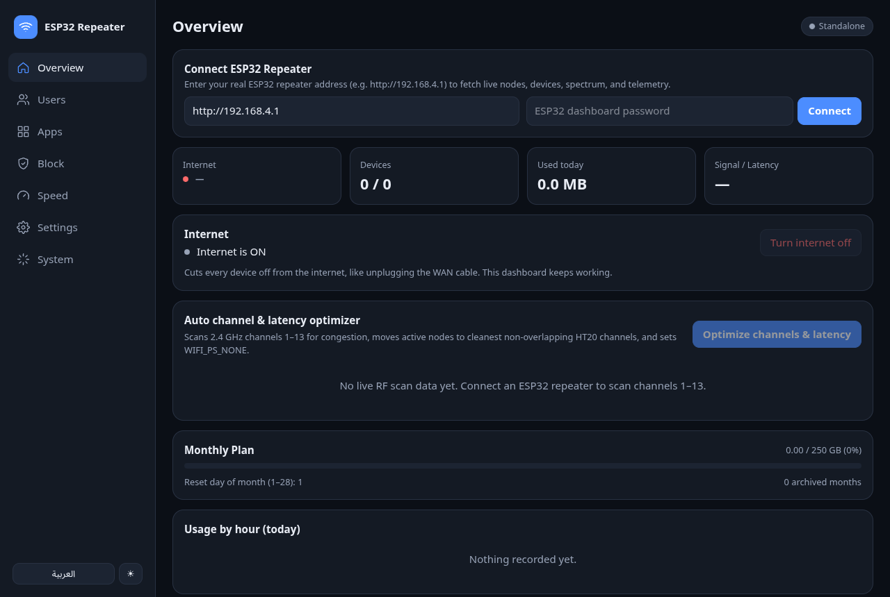
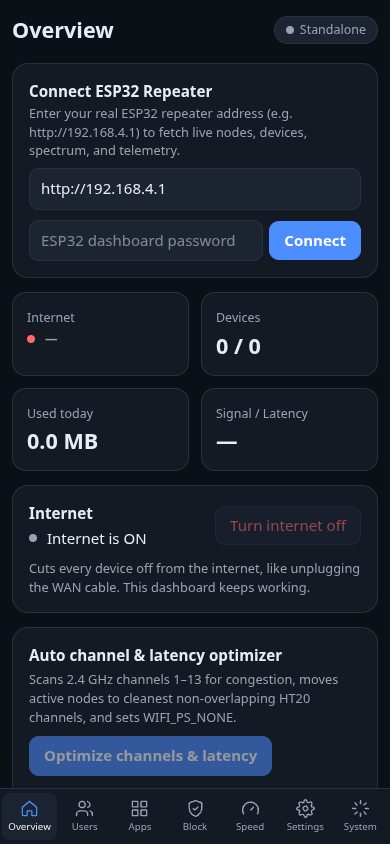
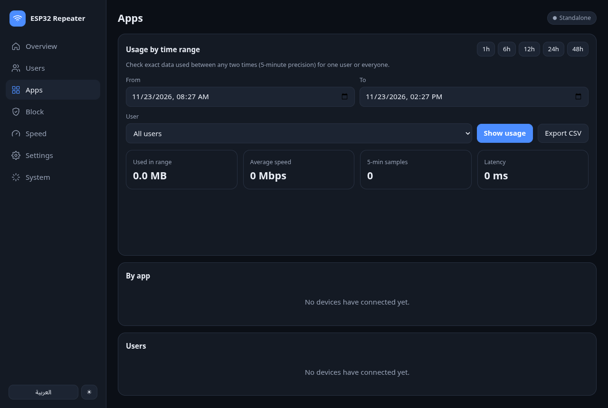
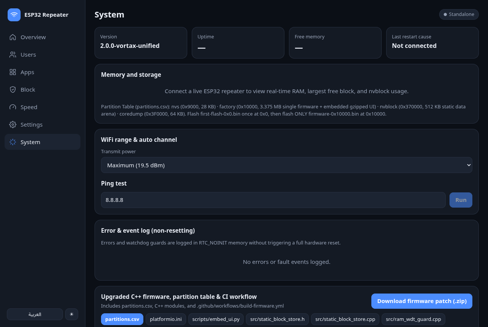
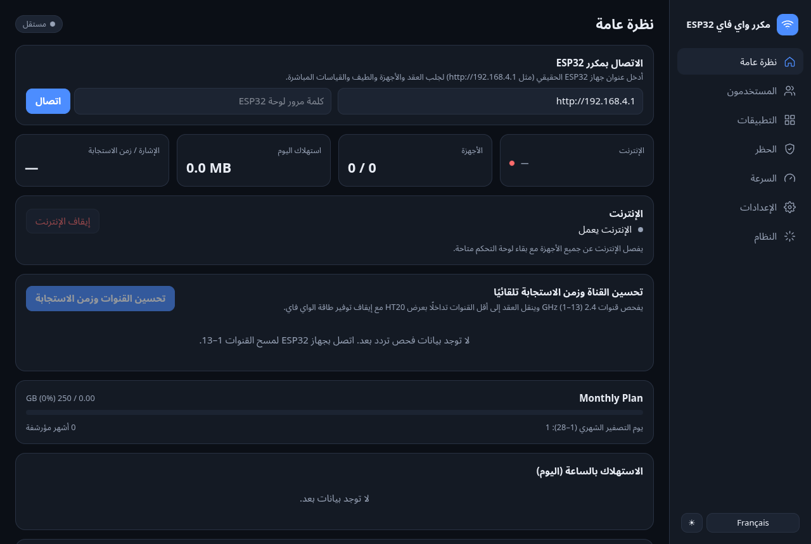
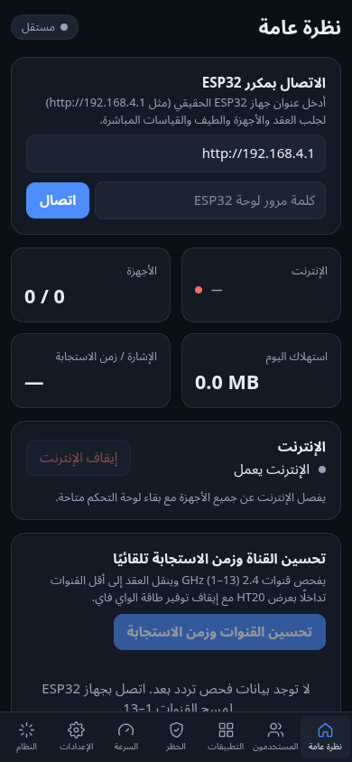
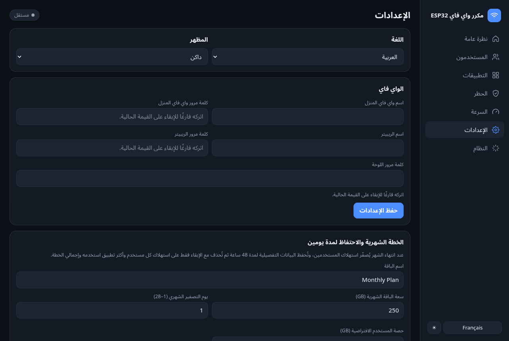
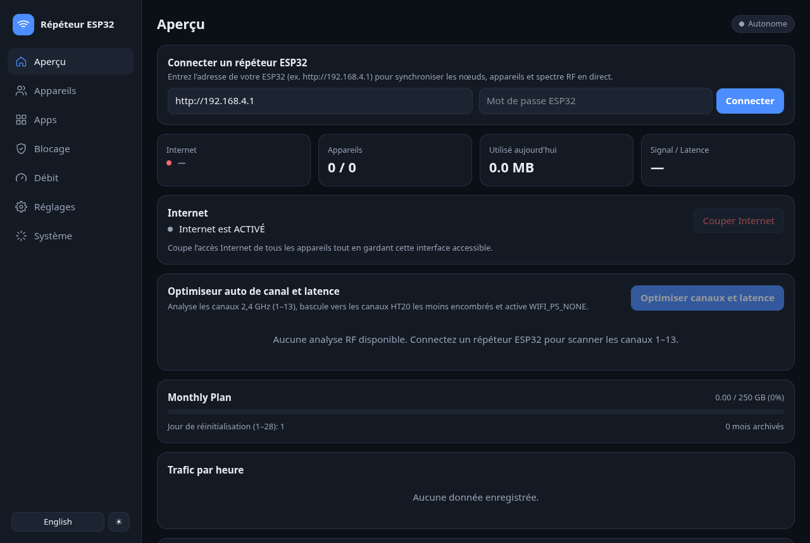

# ESP32 WiFi Repeater Manager (`v2.0`)

A lightweight, high-efficiency management console and C++/PlatformIO firmware upgrade suite for [`CodeVortax/esp32-wifi-repeater-manage`](https://github.com/CodeVortax/esp32-wifi-repeater-manage) — preserving the native dark/light router interface while upgrading RF channel optimization, RAM/Watchdog stability, monolithic static-block flash storage, precise time-window analytics, monthly rollover with 48-hour grace retention, encrypted backups, and Telegram auto-reporting.

---

## Screenshots (Multiple Languages & Mobile Responsive)

### English (LTR) — Desktop & Mobile
| Desktop Overview | Mobile Overview (390px) |
| :---: | :---: |
|  |  |

| Time-Range Usage Analytics (5-min Slices) | System, Partitions & Firmware Bundle |
| :---: | :---: |
|  |  |

### العربية (RTL) — Desktop & Mobile
| النظرة العامة (RTL) | واجهة الجوال (RTL) |
| :---: | :---: |
|  |  |

| الإعدادات والخطة الشهرية والنسخ المشفر (RTL) |
| :---: |
|  |

### Français (LTR) — Desktop


---

## Key Upgrades in `v2.0`

1. **Auto Channel & Low-Latency Optimizer**
   - Scans 2.4 GHz Channels `1–13` for adjacent/co-channel RSSI interference and switches active nodes to the cleanest non-overlapping `HT20` channels (`1`, `6`, `11`).
   - Enforces `WIFI_PS_NONE` to eliminate DTIM power-save latency spikes and prioritizes DNS, ICMP, Gaming, and TCP ACK frames in lwIP NAPT.
2. **Post-Login Crash & Watchdog (WDT) Fix**
   - Replaces the 8 parallel post-login JSON fetches with a single coalesced chunked stream (`/api/snapshot`) backed by a static TX pool, cooperative `esp_task_wdt_reset()` yields, and an `RTC_NOINIT_ATTR` fault log that records warnings without rebooting the ESP32.
3. **Precise `[From, To]` Time-Window Analytics**
   - Queries exact data consumption between any two timestamps at **5-minute slice precision** per device or across all users, with CSV export.
4. **Monthly Cycle Rollover + 48-Hour Grace Retention**
   - Automatically resets active user counters on cycle rollover, preserves raw slices in a **48-hour grace archive** before pruning, and retains compact permanent monthly digests containing each user's total usage, `#1` most-used app, and total plan consumption.
5. **Monolithic Single-Block Flash (`nvblock`) & Single-File Flashing (`0x10000`)**
   - Replaces arbitrary 16-user slots and SPIFFS uploads with a single 512 KB wear-leveled `nvblock` static arena (`128` MAC capacity via FNV-1a open addressing) and embeds the gzipped web UI directly inside `firmware.bin` (`PROGMEM`).
6. **UI-Password Encrypted Backups & Telegram Bot Auto-Backup**
   - Client-side **PBKDF2-HMAC-SHA256 + AES-256-GCM** encrypted `.vortaxbak` backup & restore keyed to your dashboard password, plus optional automatic Telegram Bot delivery on schedule or cycle rollover.
7. **Zero Mock Data / Live ESP32 HTTP Bridge**
   - Connects directly to your live ESP32 repeater (`http://192.168.4.1` or LAN IP) with disk-backed persistence (`data/repeater-store.json`) and SSRF/metadata protection.

---

## Partition Table & Flashing Guide

Full partition map in [`partitions.csv`](src/firmware/esp32Templates.ts):

| Partition | Type / SubType | Offset | Size | Purpose |
| :--- | :--- | :--- | :--- | :--- |
| `nvs` | `data / nvs` | `0x9000` | `0x7000` (28 KB) | WiFi PHY calibration & credentials |
| `factory` | `app / factory` | **`0x10000`** | `0x360000` (3.375 MB) | Single firmware + gzipped Web UI in `PROGMEM` |
| `nvblock` | `data / 0x99` | `0x370000` | `0x80000` (512 KB) | Monolithic wear-leveled static data arena |
| `coredump` | `data / coredump` | `0x3F0000` | `0x10000` (64 KB) | Panic diagnostics |

- **First-time migration only**: Flash `*-first-flash-0x0.bin` at `0x0` once so the bootloader writes the new partition table.
- **All future firmware updates**: Flash **only `*-firmware-0x10000.bin` at `0x10000`**. Bootloader, partition table, NVS, and `nvblock` data remain untouched.

> See [docs/ARCHITECTURE_AND_FLASHING.md](docs/ARCHITECTURE_AND_FLASHING.md) for binary memory layouts, esptool commands, and backup crypto details.

---

## Running Locally (Companion Dashboard & Firmware Studio)

```bash
npm install
npm run dev
```

- Server listens on `http://localhost:3000`.
- Production check:

```bash
npm run lint
npm run build
npm start
```

### Downloading Upgraded C++ Firmware Modules
Open the **System** tab in the dashboard and click **Download firmware patch (.zip)** to export `partitions.csv`, `platformio.ini`, `scripts/embed_ui.py`, all C++ modules (`src/*.cpp`, `src/*.h`), and `.github/workflows/build-firmware.yml`.

---

## Automated GitHub Releases

[`.github/workflows/build-firmware.yml`](.github/workflows/build-firmware.yml) runs on every push, PR, and `v*` tag:
1. Runs C++ host unit tests (`test/Makefile` if present) and verifies blocklist data.
2. Builds `firmware.bin` via PlatformIO (embedding the gzipped UI) and enforces `firmware.bin <= 0x360000`.
3. Builds `*-firmware-0x10000.bin`, `*-first-flash-0x0.bin`, SHA256 checksums, and `.elf.gz`.
4. Publishes official GitHub Releases on `v*` tags and updates a rolling `latest` pre-release on `master`/`main`.
